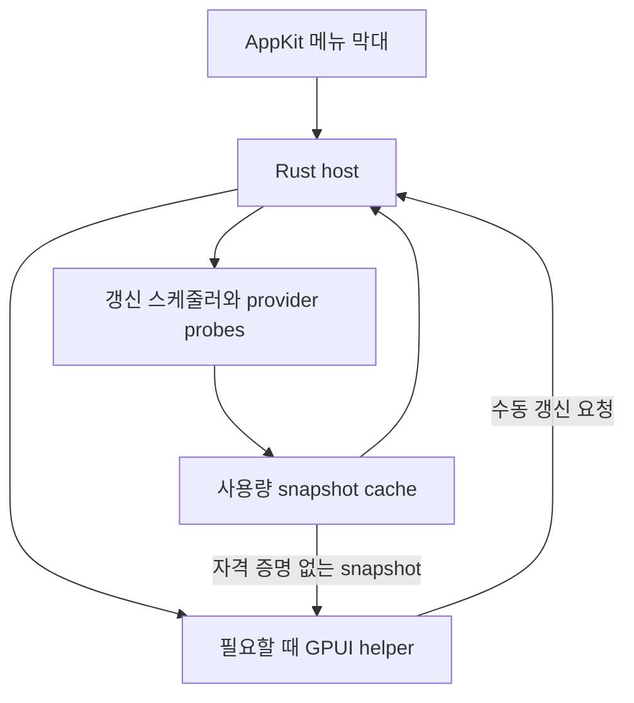

# 아키텍처

상태: 설계 초안 · 구현 및 측정 전

기준일: 2026-10-25

대상: **macOS 전용**. Windows 및 Linux 지원은 범위에 포함하지 않는다.

Light Usage Bar는 Claude, Codex, GrokBot(xAI 구독), Antigravity의 사용량을 macOS 메뉴 막대에서 확인하는 앱이다. 사용자의 우선순위는 **항상 실행해도 자원 부담이 작은 것**이다. Rust와 GPUI는 구현 수단이며, 자원 사용량에 관한 주장은 실제 측정으로 확인한다.

## 1. 결정한 것과 검증할 것

| 구분 | 내용 |
| --- | --- |
| 제품 방향 | 메뉴 막대 상주, 네 서비스 지원, 로컬 실행, macOS 전용 |
| 상주 UI | Rust에서 `objc2` 계열 바인딩으로 AppKit `NSStatusItem` 사용 |
| 상세 UI | 사용자가 열었을 때만 GPUI 패널 표시 |
| 우선 검증 후보 | 가벼운 host와 수명이 짧은 GPUI helper를 분리 |
| 비교 후보 | 이벤트 기반 단일 프로세스에서 GPUI 창을 생성·제거 |
| 확정 시점 | 같은 기능으로 두 후보를 측정한 뒤 [ADR 0001](decisions/0001-ui-process-lifecycle.md)을 갱신 |

별도 helper가 항상 더 적은 총 RAM이나 에너지를 쓴다고 가정하지 않는다. 패널을 자주 열면 반복 초기화 비용이 커질 수 있다. 최소 상주 메모리, 패널 반응 속도, 배터리 사용을 함께 판단한다.

## 2. 구성 요소

### Host

Host는 `NSStatusItem`, 서비스별 최신 snapshot, 갱신 시점, 네트워크 요청의 수명을 소유한다. 메뉴 막대 숫자와 아이콘은 표시 값이 달라졌을 때 갱신한다. GPUI helper를 사용하더라도 설치 단위는 **하나의 `Light Usage Bar.app`**이며 helper는 내부 실행 파일이다. 별도 앱을 사용자가 관리하게 만들지 않는다.

기본 Rust host에는 GPUI 의존성을 링크하지 않는 구성을 우선 검증한다. AppKit 콜백과 async channel/dispatch를 연결하고, 클릭을 찾기 위해 일정 간격으로 큐를 확인하는 루프를 두지 않는다. 런타임과 worker 수는 제한하고, blocking I/O를 main thread에서 실행하지 않는다.

### Provider probes

Probe는 공통 인터페이스를 구현하는 **조회 작업**이다. provider마다 상시 프로세스를 하나씩 둔다는 뜻이 아니다. 가능한 경로는 host의 제한된 비동기 작업으로 실행하고, CLI가 필요한 경로만 종료 시간이 있는 일회성 subprocess를 사용한다.

| Provider ID | 범위 | 표시 원칙 |
| --- | --- | --- |
| `claude` | Claude 구독 사용량 | 계정이 보고하는 quota와 로컬 작업 로그를 구분 |
| `codex` | Codex를 사용하는 구독 계정의 사용량 | 다른 OpenAI API 결제 잔액과 구분 |
| `grokbot` | GrokBot에서 사용하는 xAI 구독 | xAI API 잔액으로 대체하지 않음. 실제 조회 경로는 별도 검증 |
| `antigravity` | Antigravity 구독 및 모델별 quota | 모델·reset window별 응답 의미를 유지 |

네 서비스 모두 같은 형태의 공식 quota API를 제공한다고 가정하지 않는다. 데이터 취득 경로와 인증 방식의 검증 결과에 따라 adapter를 구현한다. 응답을 얻지 못한 경우 `unavailable` 또는 `needs_login`을 표시한다. 로컬 토큰 합계를 계정의 남은 구독량으로 환산하지 않는다.

### Snapshot cache

UI는 probe의 원시 응답 대신 버전이 있는 공통 snapshot을 소비한다. 사용량 단위, 측정 근거, 시간, 오류를 함께 보존한다.

| 필드 | 의미 |
| --- | --- |
| `schema_version` | host/helper가 합의한 형식 버전 |
| `provider_id`, `account_alias` | 서비스와 사용자에게 표시할 계정 별칭 |
| `observed_at`, `fetched_at` | 제공자가 보고한 관측 시각과 앱의 조회 완료 시각. 전자가 없으면 비워 둠 |
| `expires_at`, `next_eligible_refresh_at` | 화면의 신선도 판단과 다음 허용 요청 시점 |
| `windows[]` | session/weekly/model 등의 quota window, 단위, used/limit 또는 사용률, reset 시각 |
| `provenance` | `provider_reported`, `local_observed`, `derived`, `unavailable` |
| `source_kind` | 문서화 API, provider client 응답, 로컬 로그 등 취득 경로. 토큰·쿠키·원문 URL query는 제외 |
| `status` | `fresh`, `stale`, `refreshing`, `needs_login`, `permission_denied`, `rate_limited`, `unavailable`, `unsupported`, `needs_verification`, `error` |
| `error_code`, `last_success_at` | 사용자에게 설명 가능한 오류 분류와 마지막 성공 시각 |

`provider_reported`는 제공자 응답에서 읽었다는 뜻이며, 해당 API가 공개·안정적이라는 보증은 아니다. `derived` 값에는 계산 입력과 가정을 설명할 수 있어야 한다. 금액, 토큰, 요청 횟수, 구독 사용률은 단위를 유지하고 서로 바꿔 표시하지 않는다.

최신 성공 snapshot과 현재 조회 상태를 분리한다. 요청이 실패해도 마지막 값을 갑자기 0으로 바꾸지 않는다. UI는 마지막 값과 함께 오래됨·오류 상태를 표시한다. 계정이 바뀌면 이전 계정 snapshot을 새 계정 값으로 재사용하지 않는다.

## 3. 데이터 갱신 정책

**기본 배경 갱신 간격은 10분**으로 설계한다. 이는 설계 기본값이며 실시간성 보장이나 provider의 공식 권장 간격이 아니다.

1. 시작할 때 cache를 읽어 메뉴 막대에 표시한다. 인증된 provider의 갱신을 한 번 예약한다.
2. 하나의 스케줄러가 각 provider의 다음 조회 시각을 관리한다. 가능한 작업을 묶고 timer tolerance를 허용한다.
3. 같은 provider/account에는 한 번에 하나만 요청한다. 전체 probe 동시 실행 수는 초기 설계 상한 2개로 제한하고 측정한다.
4. 패널을 열면 cache를 즉시 보여 준다. stale인 provider만 갱신 요청하고 진행 중인 요청에 합류한다.
5. 수동 갱신도 `single-flight`와 최소 요청 간격을 통과한다. 연속 클릭이 요청 수를 늘리지 않게 한다.
6. `429`에서는 `Retry-After`를 우선 적용한다. 없으면 상한이 있는 지수 backoff와 jitter를 적용한다. 패널 재개방으로 backoff를 초기화하지 않는다.
7. `401` 등 재인증이 필요한 상태는 명확히 표시하고 자동 재시도를 중단한다. `403`은 권한·계정·endpoint 정책에 따른 거부일 수 있으므로 응답 맥락에 맞게 분류하며 재로그인만으로 해결된다고 안내하지 않는다. 앱이 뒤에서 로그인 창을 계속 열지 않는다.
8. sleep 중 놓친 interval을 wake 시 모두 재생하지 않는다. 필요한 갱신 한 번만 예약하고 네트워크 복구에 맞춰 재시도한다.

로컬 파일 변화는 가능한 OS 알림을 사용한다. 변경 알림은 debounce하고 증분으로 읽는다. 전체 세션 로그를 매 interval마다 다시 스캔하는 방식을 기본 경로로 채택하지 않는다. reset countdown은 조회와 분리하여 이미 가진 시각으로 계산한다.

## 4. GPUI 패널의 수명

### 우선 후보: 짧게 실행하는 helper

클릭 시 host는 helper가 있으면 기존 패널을 토글하고, 없으면 한 개를 생성한다. helper는 cached snapshot을 받아 첫 화면을 그린다. 업데이트는 host에서 전달한다. 닫힘·Escape·바깥 클릭 시 helper가 자신의 task와 창을 정리하고 정상 종료한다.

Host는 helper가 비정상 종료되어도 계속 메뉴 막대를 제공한다. 종료된 helper를 자동으로 무한 재실행하지 않는다. 다음 사용자 클릭 때 재시도한다. 팝업을 열지 않는 동안 host의 renderer가 존재하지 않는 구성이 목표다.

IPC는 같은 사용자 세션의 로컬 통신으로 한정한다. 메시지는 `Snapshot`, `RequestRefresh`, `Close`, `Ready`, `Error`처럼 작고 버전이 있는 형식으로 제한한다. 크기 상한, timeout, schema mismatch 처리를 둔다. **인증 토큰, 브라우저 쿠키, Keychain 원문은 IPC에 넣지 않는다.** Helper가 provider에 직접 로그인하거나 조회하지 않게 하여 데이터 경로를 하나로 유지한다.

### 비교 후보: 이벤트 기반 단일 프로세스

Host가 GPUI application context를 함께 소유하되, 시작할 때 GPUI 창은 만들지 않는다. 클릭 때 팝업을 생성하고 닫을 때 `remove_window()`와 view/task 정리를 수행한다. 숨은 keepalive 창이나 빈번한 UI tick을 기본 구조에 넣지 않는다.

이 후보는 IPC와 프로세스 시작 비용을 줄일 수 있다. 반면 팝업을 닫은 뒤에도 text system, allocator, 플랫폼 또는 GPU 관련 cache가 남을 수 있으므로 **창이 없어졌다는 사실만으로 RAM이 시작 전 수준으로 돌아왔다고 판단하지 않는다**.

## 5. 인증·오류 경계

자격 증명은 취득과 조회를 담당하는 host/probe 경로 안에 둔다. cache와 UI에는 필요한 표시용 정보만 남긴다. credential 저장·refresh 규칙은 provider별 정상 인증 흐름을 따른다. 장기 실행 브라우저, WebView, headless browser 또는 provider CLI를 사용량 감시용으로 상주시켜 두지 않는다.

Probe에는 deadline, 응답 크기 상한, 중단 가능한 작업 수명을 둔다. subprocess를 사용했다면 timeout·앱 종료 시 해당 앱이 만든 자식까지 정리한다. 오류 로그에 응답 원문, 이메일, 전체 계정 ID, token, cookie를 남기지 않는다. 진단 시에는 provider ID, 오류 분류, 응답 상태, 소요 시간, redacted source metadata만 사용한다.

## 6. 구현 참고와 확인할 제약

- [gautham-v/claudebar의 main.rs](https://github.com/gautham-v/claudebar/blob/main/src/main.rs)는 클릭 channel을 `await`하고 필요할 때 GPUI 창을 생성·제거하는 macOS 구현 사례다. [status_item.rs](https://github.com/gautham-v/claudebar/blob/main/src/status_item.rs)는 AppKit bridge 예시다. 전역 바깥 클릭 monitor는 우리 앱에서 **패널이 열린 동안만** 등록한다.
- [Aura의 lib.rs](https://github.com/Rfluid/aura/blob/main/crates/aura-ui/src/lib.rs)는 조회 당시 150ms 간격의 트레이 event drain과 macOS hidden keepalive 창을 사용했다. 기능 참고는 가능하지만 이 상시 폴링 구조는 가져오지 않는다. 이는 소스 관찰이며 CPU·RAM 측정 결과가 아니다.
- [GPUI Window API](https://docs.rs/gpui/latest/gpui/struct.Window.html)는 `refresh`, `request_animation_frame`, `remove_window`를 구분한다. 불필요한 redraw나 animation 요청을 만들지 않는다.
- [현재 GPUI macOS window source](https://github.com/zed-industries/zed/blob/main/crates/gpui_macos/src/window.rs)와 [display link source](https://github.com/zed-industries/zed/blob/main/crates/gpui_macos/src/display_link.rs)는 visibility에 따른 frame source 중단과 창 teardown을 구현한다. crates.io 버전과 upstream main은 같지 않으므로 채택 버전·commit을 고정하고 지원 OS에서 확인한다.

위 자료 확인일: 2026-10-25. 구현체의 설명을 성능 수치로 취급하지 않는다.

## 관련 문서

- [프로젝트 개요](../README.md)
- [성능 목표와 검증](performance.md)
- [비교 측정 기록](benchmarks.md)
- [ADR 0001: UI 프로세스 수명](decisions/0001-ui-process-lifecycle.md)
